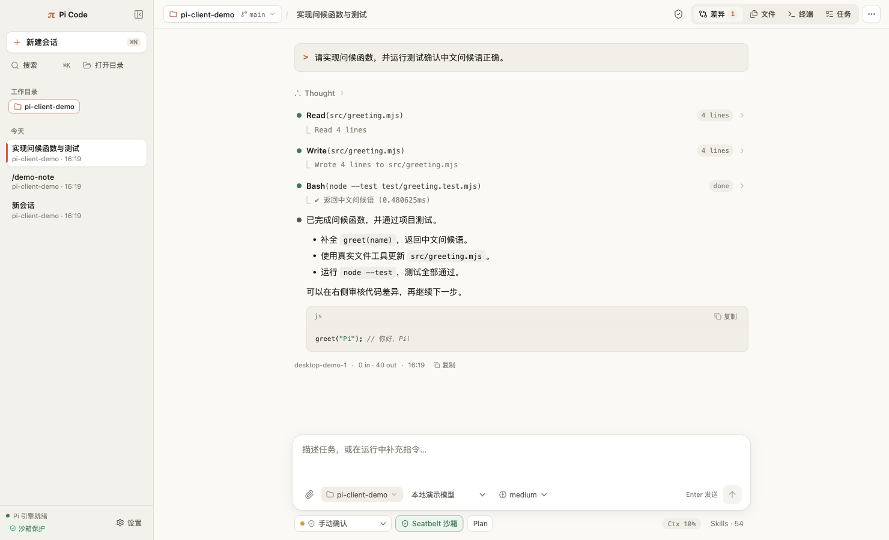
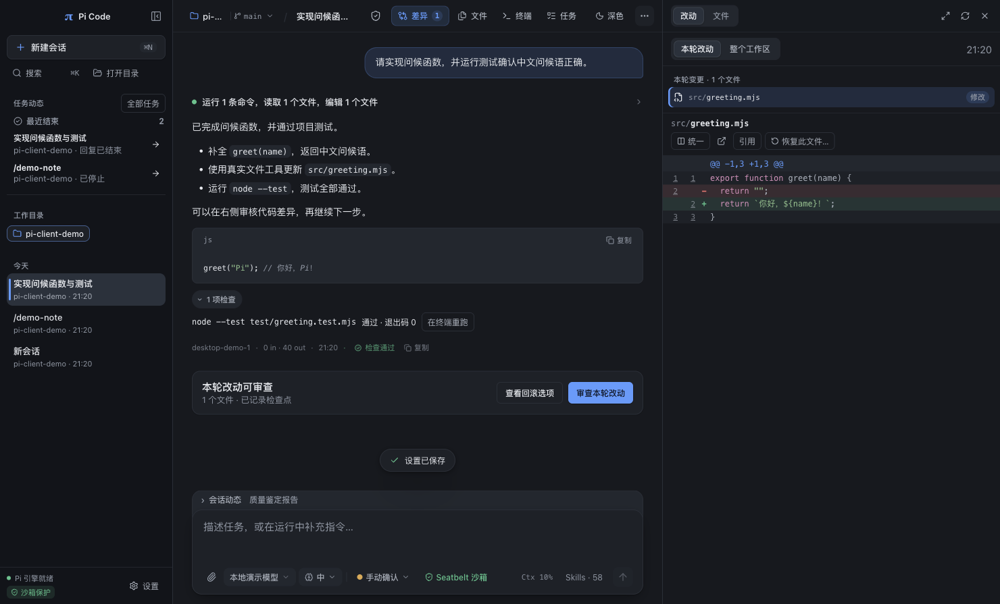

# Pi Desktop

macOS 优先的 Pi 桌面客户端。当前版本接入真实 Pi RPC 编码引擎，界面按原生 Claude Code 的视觉与交互重构：左侧会话侧栏、Claude Code 式消息流（左对齐 `>` 提示块、无边框内联工具树与 `⎿` 结果摘要、内联红绿 Diff、词法语法着色、可折叠 `∴ Thought`）、底部圆角输入框（`/` 斜杠命令与 `@` 项目文件补全、Skills 检索浮层、模型／思考／权限选择与上下文统计），以及检查点回滚、工具/MCP/权限管理、后台任务/Worktree、会话分支树与交互式 PTY 终端弹窗。旧的演示原型保留在独立入口。

这是独立客户端源码仓库。Pi 引擎通过精确版本的 npm 依赖集成，当前固定为 `1.5.2`；依赖版本与发布包完整性记录在 `package-lock.json`。上游来源及升级流程见 [UPSTREAM.md](UPSTREAM.md)，许可与归属见 [NOTICE.md](NOTICE.md) 和 [LICENSE](LICENSE)。

## 客户端截图

正式 Electron 客户端的实际运行界面。截图使用本地演示模型和临时示例项目，展示真实 Pi 文件／命令工具、会话和 Git 差异。



<details>
<summary>深色模式与代码差异</summary>



</details>

## 启动与打包

开发环境需要 Node.js **22.19.0 或更新版本**、npm、Git 和 C 编译器。macOS 可使用 Xcode Command Line Tools 提供的编译器。测试直接运行 TypeScript 源码，类型检查使用仓库锁定的 TypeScript 与 Node 类型包。

在本仓库根目录安装并构建：

```sh
npm ci --ignore-scripts
npm run build
```

构建直接使用已安装 Pi npm 包中的运行时，不需要另行克隆或构建 Pi 核心。`--ignore-scripts` 会跳过 Electron 的安装脚本，首次开发启动前须显式下载 Electron 平台运行时：

```sh
node node_modules/electron/install.js
npm run start
```

生成可运行的应用目录或 macOS ZIP：

```sh
npm run package
npm run dist:mac
```

打包时 electron-builder 会自行下载配置指定的 Electron 运行时，不要求先执行开发启动用的下载步骤。macOS Apple Silicon 的应用目录输出为 `release/desktop/mac-arm64/Pi Desktop.app`；应用内置 Electron 的 Node 运行时与 Pi RPC bundle，最终用户不需要安装 Node、编译器或 Pi。打包配置见 `desktop-builder.json`。日常构建使用未签名的开发包，发行包可运行 `npm run dist:mac:signed`。签名发行需要 Developer ID Application 证书和 Apple 公证凭据，凭据通过环境变量提供。Windows 构建跳过 POSIX PTY，Windows 客户端使用单次命令面板。 [electron-builder 签名文档](https://www.electron.build/v26/docs/features/code-signing/)

## 模型配置

默认读取 Pi 标准目录 `~/.pi/agent`，包括已有模型、认证、设置和扩展。若设置了 `PI_CODING_AGENT_DIR`，则读取该目录。可在客户端设置中指定其他配置目录。

首次使用时，在设置中选择 DeepSeek、Anthropic、OpenAI、Google 或 OpenRouter，填写 API Key 后点击“保存并使用”即可。客户端已内置官方地址、接口协议、推荐模型和模型能力参数；模型下拉列表也可直接选择其他内置模型，不需要手输模型 ID。不要将密钥发送到聊天中。

DeepSeek 默认使用 `deepseek-flash`，并提供 `deepseek-v4-pro`；模型与能力来自此版本 Pi 的内置目录。保存服务商后，聊天区的模型选择器会显示其全部内置模型，切换后可恢复。

第三方中转或自建服务请展开“高级设置”，使用自定义接口并按服务商说明填写模型 ID、基础地址和协议。可选择 Anthropic Messages、OpenAI Responses、OpenAI Chat Completions 或 Google Gemini。API 地址不包含具体请求路径、密钥或查询参数；兼容 OpenAI 的中转接口通常选择 Chat Completions，地址是否包含 `/v1` 以服务商说明为准。已有自定义连接会保留，切回官方预设需主动选择。

“测试连接”可在保存前验证密钥和所选模型。测试通过独立 Pi 进程发送一条最小请求，不加载项目文件、上下文、工具或第三方扩展，不写入当前会话；请求可能计入模型用量。保存的连接会用于当前会话和新会话，已有会话恢复其原来的模型。未修改的密钥留空即可保留。

客户端内新增的密钥通过 Electron `safeStorage` 加密保存。客户端自定义连接注册为独立的 `desktop-<provider>`，不会覆盖 Pi 的原有 `auth.json`、`models.json` 或登录状态。密钥不会返回渲染进程，也不放在进程启动参数中。已有订阅/OAuth 登录可通过原有 Pi 配置复用；当前没有独立的 OAuth 登录向导。

## 已接入

以下列出界面已有功能与后端能力。检查点审核／恢复、交互 PTY、后台任务／外部执行器／Worktree、工具与权限规则、项目信任、会话分支／树导航／CLI 历史导入均已接入界面入口与 `window.pi` 接口。

- 本地项目选择；新建、切换、重命名会话；会话持久化与重启恢复。
- 真实模型列表、模型切换、支持的思考强度、流式文本、思考过程（`∴ Thought`）与用量/上下文统计。
- Pi 的真实读写文件、多段编辑和命令工具；Claude Code 式无边框工具树、`⎿` 结果摘要、内联红绿 Diff 与代码语法着色。
- 手动确认、接受编辑、跳过确认（危险）和只读模式；接受编辑仅自动允许项目内文件编辑，命令仍按规则询问；权限弹窗支持 Diff/源码预览与“始终允许”快捷规则；扩展确认、选择、输入和编辑器对话框。
- 停止任务（含 `Esc` 快捷键）、运行中追加引导消息、直接执行命令、停止命令；`Shift+Tab` 快速切换权限模式与 `↑`/`↓` 历史输入翻阅。
- 排队中的指令可以停止当前生成后立即发送，也可以连同附件撤回到输入框。草稿正文和附件按会话保存在本机，切换会话、重载窗口或退出重开后均可恢复。
- 实际项目文件查看、Git 分支状态及语法着色的修改差异审核，支持一键插入 `@文件引用`。
- 文本和图片附件、可检索 Skills 浮层、`@` 文件与 `/` 命令补全、会话 HTML 导出与上下文压缩。
- 工具清单、工具与细粒度权限管理弹窗：支持全局／项目／会话作用域启停、恢复继承以及 `allow / ask / deny` 规则增删。
- MCP 服务器管理（`/mcp`）：读写用户 `~/.pi/agent/mcp.json` 与项目 `.pi/mcp.json`，支持 stdio/HTTP 增删、启停和描述；保存后重启当前项目会话，已启用的 HTTP 服务器可从管理面板打开 OAuth 登录终端，凭据由 Pi 保存。
- 项目信任：打开含 `.pi/settings.json`、`.pi/mcp.json`、`.pi/agents`、`.claude/agents`、`.pi/extensions`、`.pi/skills`、`.pi/prompts`、`.pi/SYSTEM.md` 或祖先 `.agents/skills` 的项目时显示信任横幅与资源清单；未信任时不加载这些项目配置，信任后重启会话生效，顶栏可随时更改。`跳过确认（危险）` 模式有常驻风险提示。
- 模型主动 `Agent` 委派、前台等待／后台结果回传、只读 Explore／Plan 与 Worktree 编码子任务；后台任务与 Worktree 弹窗支持查看详情、子任务审批、停止、快进合并与安全清理。
- 自定义 Agent（`/agents`）：兼容读取 `.claude/agents` 与 `.pi/agents`（项目级需项目信任），支持名称、描述、提示词、工具白名单 / `disallowedTools`、模型/别名（`sonnet`/`opus`/`haiku`/`inherit`）、思考强度（`effort`/`thinkingLevel`）、`permissionMode`（含 `dontAsk`）、`maxTurns`、预加载 `skills`、`memory`（`agent-memory`）、`isolation`/`background` 与作用域 `hooks`；`Agent` 工具可按名称委派，支持 `fork: true` 继承父会话上下文快照，只读定义自动共享、可写定义默认 Worktree。
- 本机 Codex／Claude Code／Kimi Code／Antigravity CLI 执行器：主动委派、原生会话持续协作、审批、结果回传和取消；支持在界面启用/停用、配置可执行路径并管理任务审批与续写。
- Git 检查点（`/rewind`）：Pi 提示和直接命令自动捕获，支持弹窗差异对比、按单文件或全部安全恢复及冲突提示。
- Git 暂存、放弃修改与提交，以及 Unified / Split（分栏）Diff 视图切换。
- 原生交互式 PTY 终端：界面支持单次命令与交互 PTY 双页签，支持多终端创建、标准输入、Ctrl-C、输出回放与子进程清理。
- 会话分支树与 Pi CLI 历史导入（`/sessions`）：浏览会话分支树、节点跳转/分叉、克隆当前分支，以及发现并显式导入 Pi CLI 历史副本。
- Claude Code 对等增强（Phase 1–3）：
  - **引擎级 Plan 模式 & 结构化交互**：独立 `plan` 权限模式（只读调研、放行 `WebFetch` 与 `Explore/Plan` 只读子 Agent、允许写入 `.pi/plans/<id>.md` 并阻断源码写入与写命令），配合 `ExitPlanMode`、计划正文预览/编辑审批栏与 `AskUserQuestion` 多选/表单提问卡片；另内置 `TodoWrite` 任务进度清单、`WebFetch`（带内网隔离）与 `NotebookEdit`（`.ipynb` 单元格编辑）。
  - **Claude 兼容 Hooks 引擎（`/hooks`）**：支持 `~/.claude/settings*.json`、`~/.pi/agent/hooks.json`、受信任项目内 `.claude/settings*.json` / `.pi/hooks.json` 以及 Agent frontmatter 作用域 hooks，涵盖 11 个事件（`PreToolUse`、`PostToolUse`、`PostToolUseFailure`、`PermissionRequest`、`UserPromptSubmit`、`Stop`、`SubagentStart`、`SubagentStop`、`PreCompact`、`SessionStart`、`Notification`），支持 `command` 与 `http`（`allowedEnvVars` Header 注入）handler、正则 matcher、`updatedInput`（带权限二次重验）、exit code `2` / JSON 决策拦截、防循环 Stop 阻断与测试触发。
  - **上下文分析、分层记忆与压缩控制（`/memory` / `/context` / `/status`）**：支持编辑根目录 `AGENTS.md` / `AGENTS.override.md` / `CLAUDE.md` / `CLAUDE.local.md` 与 `.claude/rules/*.md`（含 `paths:` 与 `@import` 解析）、`/init` 引导、分段上下文占用可视化、缓存命中率、`autoCompaction` / `autoRetry` 开关以及 `/compact [指令]`。
  - **权限规则共享、Skills、侧问与效率工具**：支持将项目规则双向导入/导出 `.claude/settings.json`；`/skills` 支持查看与新建 `.pi/skills` / `.claude/skills`；支持 `/btw <问题>` 不污染主会话的独立侧问、`/preview` 本地网页预览（仅 `localhost`）、`⌘F` 会话内检索、`⌘P` 全局命令面板、窗口失焦桌面通知，以及设置中可选的 macOS `sandbox-exec`（Seatbelt）Bash 命令沙箱开关。

新增后端能力通过 preload/IPC 提供给负责界面的开发者。完整接入契约、示例与限制见 [后端接口文档](docs/backend-api.md)。

工具控制及 Claude Code 风格的子任务卡片接入见 [工具与委派文档](docs/tools-and-delegation.md)。外部执行器使用方式、能力限制和前端事件契约见 [本机多 Agent 接入](docs/local-external-agents.md)。

权限确认作用于 Pi 工具调用，默认不等同于操作系统沙箱。在 macOS 设置中启用 Seatbelt 后，Bash 命令仅可写当前项目和临时目录，并可关闭网络访问。交互终端、MCP、Hooks 和模型连接各自运行。

### 日常工作流

1. 在前台会话运行时，可从侧栏切到其他会话。待确认的工具可选「稍后处理」，切回原会话恢复审批、流式内容和当前窗口的独立草稿。并行写入使用不同项目或 Worktree。关闭桌面应用会结束本地进程，重新启动后可以读取已保存历史。
2. 在「代码修改」点击 Diff 行号，将带文件路径和行号的评审反馈加入会话草稿。「PR 与 CI」使用已登录的 `gh` 读取 PR、每 30 秒刷新检查状态，并可从已推送分支创建草稿 PR。「本地网页预览」的「验证页面」使用隔离的 Chromium 读取同源页面，报告 HTTP 状态、标题和浏览器错误。
3. 信任项目后，文件面板的「代码分析」可检查诊断和文档符号，并按文件位置跳到项目内定义。JS／TS、Python、Go、Rust 分别需要在 PATH 配置 `typescript-language-server`、`pyright-langserver`、`gopls`、`rust-analyzer`。项目规则支持 `.claude/rules`、`.pi/rules` 和 `paths` 匹配，支持展开项目内 `@文件` 和 Markdown 导入。通过 `/memory` 编辑的「本机项目记忆」保存在应用数据中，在受信任的同项目会话间复用。
4. 在设置中开启 macOS 命令沙箱，可附加网络隔离。在 MCP 面板点击「OAuth 登录」。终端的「Pi 扩展」可列出、安装、更新或移除用户级 npm 扩展包，「SSH」可用系统 OpenSSH 配置打开远端 Shell 或 Pi。远端接入使用独立终端，审批与会话记录留在远端。

## 数据和限制

桌面会话索引及客户端设置保存在 Electron 的应用数据目录，实际会话 JSONL 保存在该目录的 `sessions/`。桌面端不自动导入 CLI 的所有历史会话。

项目信任决定保存在应用数据目录 `desktop.json` 的 `projectTrust` 字段。未信任项目只加载用户级 Pi 配置与 `AGENTS.md` / `CLAUDE.md`；信任后才会加载项目 `.pi` 受保护资源，并重启该项目会话。该机制不等于 OS 沙箱。

终端面板同时提供原单次命令模式与真实交互式 PTY 页签（`window.pi.terminals`）；网页预览出于安全原因仅允许加载 `localhost` / `127.0.0.1` 本地地址。SSH 支持在桌面终端连接远端或启动远端已安装的 Pi。云端托管、手机接管、将 SSH 会话纳入本地 Agent 委派与审批，以及自动更新仍待实现。自定义连接匹配 Pi 已知的服务商和模型 ID 时，沿用其能力与计费元数据；未知模型使用通用上下文、输出上限和占位价格。

`PI_DESKTOP_DATA_DIR` 和 `PI_DESKTOP_WORKSPACE` 可指定独立的数据和初始项目目录，供开发及隔离验证使用。普通启动会等待用户选择项目，不会把 Finder 的当前目录当成项目。

## 校验

```sh
npm run check
node --test test/*.test.ts
```

首次校验前先执行 `npm ci --ignore-scripts` 和 `npm run build`。类型检查不启动模型；测试使用的原生 PTY helper 由构建步骤生成。

macOS 实际窗口与前后端互通验证：

```sh
npm run package
npm run verify:client
# 同时重新生成上方的客户端截图：
npm run verify:client -- --screenshots
```

交互验证会启动正式打包应用，使用独立临时目录和本地演示模型，检查模型／思考选择、附件隔离与限制、工具审批、流式重载恢复与停止、文件修改与 Git 差异、命令面板，以及真实 preload 的会话树、检查点、PTY、后台任务和 Worktree 接口。

测试使用独立临时目录与脚本化本地测试模型，运行真实 Pi Agent 循环和读写/命令工具，不使用真实模型凭据或付费 API。

模型连接测试另外启动本地 HTTP/SSE 服务，验证实际 Pi 请求的协议、认证、错误处理和密钥隔离。macOS 客户端另已完成 DeepSeek 真实连接及只读项目分析验收；凭据和会话数据不随源码发布。Google 协议尚未完成本地服务或真实服务验证，其他服务商的真实账户权限也未逐一验收。

## Langfuse 追踪

Pi Desktop 从本机加密设置读取 Langfuse 地址和两把密钥。自托管地址使用实例根地址，客户端会自动添加 `/api/public/otel/v1/traces`。也可以通过 `LANGFUSE_BASE_URL`、`LANGFUSE_PUBLIC_KEY` 和 `LANGFUSE_SECRET_KEY` 为一次启动指定连接。

首次配置或更换密钥前先退出客户端。在 macOS 的 zsh 终端交互式输入，保存后即可从 Dock 正常启动。

```zsh
read -r 'LANGFUSE_BASE_URL?Langfuse URL: '
read -r 'LANGFUSE_PUBLIC_KEY?Langfuse public key: '
read -rs 'LANGFUSE_SECRET_KEY?Langfuse secret key: '
printf '\n'
LANGFUSE_BASE_URL="$LANGFUSE_BASE_URL" \
  LANGFUSE_PUBLIC_KEY="$LANGFUSE_PUBLIC_KEY" \
  LANGFUSE_SECRET_KEY="$LANGFUSE_SECRET_KEY" \
  node -e 'const e=process.env; process.stdout.write(JSON.stringify({baseUrl:e.LANGFUSE_BASE_URL,publicKey:e.LANGFUSE_PUBLIC_KEY,secretKey:e.LANGFUSE_SECRET_KEY}))' \
  | '/Applications/Pi Desktop.app/Contents/MacOS/Pi Desktop' --configure-langfuse
unset LANGFUSE_PUBLIC_KEY LANGFUSE_SECRET_KEY LANGFUSE_BASE_URL
```

在 Langfuse 的 Traces 中筛选环境 `pi-desktop`。每轮 Pi Agent、`/btw` 和 `/grail` 模型评审各自记录一条运行 Trace，下面显示模型 Generation 和工具耗时。相同会话通过匿名 ID 分组。Generation 记录模型、结束状态、用量、缓存读写和 Pi 报告的美元费用。可设置 `LANGFUSE_RELEASE` 为提交号，用于区分版本。

默认只发送元数据。需要查看正文时，先退出客户端，再运行 `'/Applications/Pi Desktop.app/Contents/MacOS/Pi Desktop' --enable-langfuse-content`。用 `--disable-langfuse-content` 恢复仅元数据。一次性环境配置可以通过 `LANGFUSE_CAPTURE_CONTENT=1` 启用。

开启后，常规对话的 Trace 记录当轮用户可见文本和助手回复，Generation 记录当轮已观测的消息、可见输出和工具名称，工具步骤记录完成状态。`/btw` 只记录用户输入的侧问和成功返回的答复。`/grail` 仅记录模型、用量、费用、耗时和状态等元数据。正文会去除常见凭据及内网 IP 并限制长度。附件、引用文件正文、隐藏推理、原始工具参数与结果保留在本机。外部 Agent 适配器内部的独立模型调用目前由各自的运行时管理。跨机器传输时使用 HTTPS。 [Langfuse OpenTelemetry 文档](https://langfuse.com/integrations/native/opentelemetry)

## 旧界面原型

```sh
npm run prototype
npm run prototype:app
```

`prototype/index.html`、端口 4317 的原型页面及 `Pi Desktop Preview.app` 均是早期演示入口，不连接正式客户端后端。演示中的代码和执行输出为预设数据；正式入口是 `Pi Desktop.app`。

## 源码与本地数据

提交客户端源码、文档、合成测试数据和锁文件。构建产物、依赖目录、环境文件、密钥、个人 Pi 配置、会话 JSONL、终端记录和运行日志不应进入仓库；测试和应用数据使用仓库外的独立目录。发布源码前也应检查暂存清单，避免把本地验收数据、截图或录制带入提交。
